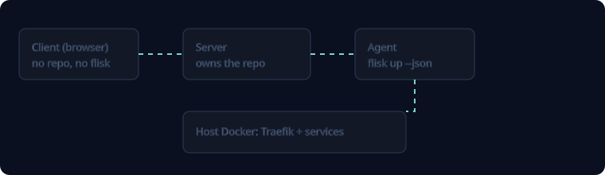

# Agent hosts: Dev Containers, Codespaces, cloud agents, WebContainers

`flisk doctor` reports where it is running (`data.host.kind` in `--json`): `local`, `wsl2`, `devcontainer`, `codespaces`, `webcontainer`, `native-windows`, or a cloud coding-agent host (`claude-code-web`, `codex-cloud`, `copilot-agent`). `data.host.containerRuntimeReachable` says whether doctor found a working container runtime (Docker, Colima, Kiri or Podman), and `data.host.canUp` is false when `flisk up` cannot work: on a WebContainer, on native Windows without `FLISK_ALLOW_NATIVE_WINDOWS=1`, or when no container runtime is reachable.

## Dev Containers and Codespaces

Services run as sibling containers on the host's Docker engine; the Dev Container is only where the agent and `flisk` live.

- Supported: Docker-outside-of-Docker. Mount the host socket (`-v /var/run/docker.sock:/var/run/docker.sock`) or add the `docker-outside-of-docker` Dev Container feature.
- Not supported: Docker-in-Docker (Tilt bind mounts and the layer cache break).
- A mounted Docker socket gives the container root-equivalent access to the host. Only do this in workspaces you trust.

If Docker is unreachable, `flisk up` exits non-zero without starting Tilt and `flisk doctor` prints this remediation.

## Cloud agents

Claude Code on the web, OpenAI Codex cloud and the GitHub Copilot coding agent run in sandboxes, usually without a Docker daemon. A container stack cannot run there, but a project whose services declare `command` runs as local processes: no Docker, no Tilt. `flisk doctor` detects the host (`data.host.kind` is `claude-code-web`, `codex-cloud` or `copilot-agent`) and prints the matching guidance; `flisk up` refuses a container project on that host and runs a local-process one as usual.

The setup is the same three commands on every host: install Flisk and Bun, scaffold a local-process agent, start it with `flisk up --json`. The agent answers `POST /turn` with an `x-session-id` header on `http://localhost:<port>`, and `flisk agent sessions <name> --json` lists its checkpoints. The e2e suite runs exactly this sequence (case `N1` in `tests/e2e/resource-types/agent`), so these recipes are exercised in CI.

- `flisk project --yes` writes a Flisk project the sandbox owns. Keep it out of the repo the agent edits (`$HOME/flisk-agent` below), or the generated services land in the agent's diff.
- `flisk resource bot --type agent --local --yes` scaffolds the `custom` agent runtime as a local process: a `command` in `service.json` instead of a Dockerfile, `files` durability under `.agent-state/`, listening on `localhost`. The generated service implements the agent contract — `GET /health`, `GET /ready`, `POST /turn`, `GET /sessions` — and needs no `npm install` step for files durability (Node built-ins only).
- `flisk up --json` starts the service as a local process and prints the readiness envelope, then keeps supervising in the background, so scripts run it with `nohup ... &`.

### Codex cloud

The environment's setup script (Environments → setup script) runs with internet access; the agent phase may have it disabled, so every install happens here and `flisk up` needs no network at all:

```bash
#!/usr/bin/env bash
set -euo pipefail
npm install -g bun @flisk-sh/flisk

# Outside the repo, so the generated services stay out of the task's diff.
mkdir -p "$HOME/flisk-agent" && cd "$HOME/flisk-agent"
flisk project --yes
flisk resource bot --type agent --local --yes
nohup flisk up --json >> up.log 2>&1 &
```

`flisk` and `bun` installed here stay on the PATH the agent phase inherits. The agent can also (re)start the stack itself mid-session: `cd ~/flisk-agent && flisk up --json`. `flisk doctor` on this host reports `codex-cloud`.

### Claude Code on the web

`.claude/settings.json` in the repo, with a `SessionStart` hook that runs the setup script. `CLAUDE_CODE_REMOTE=true` marks the hosted environment, so the same hook exits quietly on a local session:

```json
{
  "hooks": {
    "SessionStart": [
      {
        "matcher": "startup",
        "hooks": [
          { "type": "command", "command": "bash \"$CLAUDE_PROJECT_DIR\"/.claude/flisk-up.sh" }
        ]
      }
    ]
  }
}
```

`.claude/flisk-up.sh`:

```bash
#!/usr/bin/env bash
[ "${CLAUDE_CODE_REMOTE:-}" = "true" ] || exit 0
set -euo pipefail
command -v bun   >/dev/null 2>&1 || npm install -g bun
command -v flisk >/dev/null 2>&1 || npm install -g @flisk-sh/flisk

cd "$HOME/flisk-agent" 2>/dev/null || { mkdir -p "$HOME/flisk-agent" && cd "$HOME/flisk-agent"; }
[ -f .flisk/project.json ] || flisk project --yes
[ -d services ]            || flisk resource bot --type agent --local --yes
pgrep -f "flisk up" >/dev/null 2>&1 || nohup flisk up --json >> up.log 2>&1 &
```

`flisk doctor` on this host reports `claude-code-web`.

### GitHub Copilot coding agent

`.github/workflows-disabled/copilot-setup-steps.yml` in the repo. Copilot on GitHub Actions runs its one `copilot-setup-steps` job before the session starts (the file must be on the default branch):

```yaml
name: Copilot setup steps

on:
  workflow_dispatch:
  push:
    branches: [main]
    paths: [".github/workflows-disabled/copilot-setup-steps.yml"]
  pull_request:
    paths: [".github/workflows-disabled/copilot-setup-steps.yml"]

jobs:
  copilot-setup-steps:
    runs-on: ubuntu-latest
    steps:
      - uses: actions/checkout@v5
      - uses: actions/setup-node@v4
        with:
          node-version: "22"
      - name: Install Flisk and Bun
        run: npm install -g @flisk-sh/flisk bun
      - name: Scaffold a local-process agent
        run: |
          mkdir -p "$HOME/flisk-agent" && cd "$HOME/flisk-agent"
          flisk project --yes
          flisk resource bot --type agent --local --yes
      - name: Start it with flisk up --json
        run: |
          cd "$HOME/flisk-agent"
          nohup flisk up --json >> up.log 2>&1 &
```

`flisk doctor` on this host reports `copilot-agent`. A GitHub-hosted runner does carry Docker, so a container project works there too; the local-process recipe is the one that also works in a locked-down sandbox.

## T3-style servers

A server that owns the repo and starts the agent (for example T3 Code) works when the agent runs `flisk` on a machine with Docker, with the services running as sibling containers on that host.



The agent runs `flisk doctor`, then `flisk up --json` in the background, and polls `flisk status --json` for ports and URLs. Do not point such a server at a WebContainer: `canUp` stays false there.

## MCP server

`flisk mcp` runs a Model Context Protocol server over stdio, for agents that speak MCP instead of shelling out. Add it to the client's MCP config, started from the project directory:

```json
{ "mcpServers": { "flisk": { "command": "flisk", "args": ["mcp"] } } }
```

Tools (each runs the matching command, so they behave exactly like the CLI): `doctor`, `up`, `down`, `status`, `wait`, `logs`, `resource_list`, `resource_restart`, `resource_run`, `agent_list`, `agent_sessions`, `stack_list`, `project_info`, `project_templates`, `network_list`, `config_verify`, `config_explain`, `runtime_check`, `tool_add` (adds a tool by name and rejects cloud providers), `project_eject` (refused unless `confirm` is `true`) and `project_import` return the command's `--json` envelope; `project_templates` returns the starter template catalog (`flisk project --list --json`); `config_regenerate` (a dry run unless `dryRun` is `false`), `resource_create` and `stack_assign` return its `--json` envelope too, while `project_init` returns its text output. Arguments are validated before anything runs: names may contain letters, digits, `.`, `_` and `-` only, and a name `resource_create` creates follows the command's own stricter rule (lowercase letters, digits and hyphens). The former names `restart_resource`, `list_agents` and `get_agent_sessions` are still accepted by `tools/call` but not listed. For the install path and per-client configuration, see the [Flisk MCP setup guide](agent-tooling/flisk-mcp-setup.md).

- `up` takes `stack`, `only` (service names), `force` and `waitSeconds`. It starts Tilt detached and returns without waiting for the stack to be ready, since a build can outlast a tool call. It watches only for an early refusal (`UNKNOWN_SERVICE`, `TILT_ALREADY_RUNNING`, an unsupported host) and otherwise returns `started: true` with the process id and a log file. Poll `status` until `data.tilt.readiness.ready` is true (`data.readiness.ready` in a local-process project).
- `status` includes `data.tilt.readiness` (`ready`, `pending`, `failures`, `enabled`), which is `null` when no Tilt answers. The same field is on `flisk status --json`; a project of local-process (`command`) services has no `tilt` block and reports readiness as `data.readiness` instead.
- `logs` is a bounded snapshot; there is no streaming tool.

## WebContainers

Not supported for `flisk up`. A WebContainer has no Docker daemon, Compose, or Tilt. `flisk doctor --json` reports `canUp: false` and `flisk up` exits non-zero without spawning Tilt. Run Flisk on a machine with Docker and call it from the agent.

## JSON output for agents

- `flisk doctor --json` and `flisk status --json` print a versioned report.
- `flisk up --json` prints one object on stdout: `ok: true` once every non-deferred Tilt resource is built and running and its Docker health check, if it has one, has passed, or `ok: false` with `errors` if a resource fails, readiness times out (`FLISK_UP_READY_TIMEOUT_MS`, default 15 minutes), a smoke check fails, or Tilt exits first. Tilt keeps running after the object is printed, so background the command. Human output is suppressed.
- `flisk up [stack] --only <service...>` starts just those services plus the services they depend on (`dependsOn`) and shared infrastructure. Unknown names are rejected (`UNKNOWN_SERVICE`, exit 2) and it refuses to start while a Tilt already answers on port 10350 or `TILT_PORT` (`TILT_ALREADY_RUNNING`; use `flisk down`, or `--force`). With a stack argument, names must belong to that stack, but dependencies may cross stacks. With `--json`, readiness covers only what Tilt enabled, and the result lists `requested` and `dependencies` (what Tilt enabled besides the requested services; a dry run gives `declaredDependencies` from `service.json`).
- `flisk logs --json [--service <name...>] [--tail <n>] [--since <duration>] [--port <n>]` prints one object with the most recent lines (default 200, never unbounded) and exits. Each line has `time`, `resource`, `level`, `source` and `text`. `--tail` is 1 to 10000. `--since` filters on real event times from Tilt's log store (via `tilt dump webview`), not the query time; `time` is the recorded event time. An unknown service is an error that lists valid names (when Tilt cannot list its resources, that check is skipped and the logs call reports the real error). Errors are `USAGE` (exit 2), `UNKNOWN_SERVICE` (exit 2), `TILT_MISSING`, `TILT_NOT_RUNNING` (no Tilt server answered), `TILT_LOG_TIMES_UNAVAILABLE` (Tilt could not supply timestamps for `--since`) and `TILT_LOGS_FAILED` (Tilt rejected the call). It reads from the running Tilt on localhost (`--port`, or `TILT_PORT`). There is no follow mode in JSON.
- `flisk down --json` prints one object when done, including when preflight fails.
