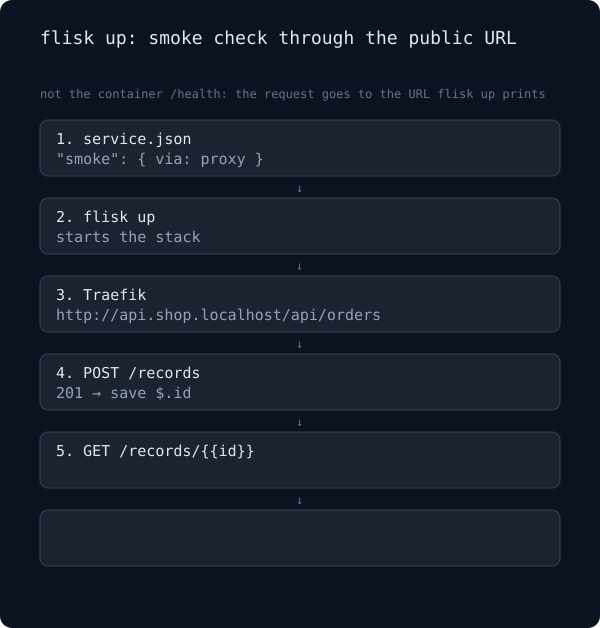

# Smoke-Test

> Diese Seite ist eine deutsche Übersetzung von [smoke.md](smoke.md). <!-- spellchecker:disable-line -->

`flisk up` kann Ihren Dienst über die ausgegebene URL prüfen, nicht nur im Inneren des Containers. Die Zeichnung durchläuft denselben Pfad zweimal: Zuerst funktioniert die Route (201, dann 200, „Smoke check passed"), dann liefert der erneute Lesezugriff ein 404 („Smoke check failed", `flisk up` endet mit dem Exit-Code 1). <!-- spellchecker:disable-line -->

<p align="center">
  
</p>

GitHubs Blob-Ansicht zeigt diese Zeichnung oft ohne die Animation. [Öffnen Sie das rohe SVG](assets/smoke.svg), um die Schleife zu sehen (etwa 16 Sekunden: 8 für den Erfolg, 8 für den Fehlschlag). <!-- spellchecker:disable-line -->

```json
{
  "smoke": {
    "via": "proxy",
    "timeoutSeconds": 60,
    "steps": [
      { "name": "create", "method": "POST", "path": "/records", "body": { "name": "smoke" }, "expect": 201, "save": { "id": "$.id" } },
      { "name": "read back", "path": "/records/{{id}}", "expect": 200, "bodyContains": "smoke" }
    ]
  }
}
```

Die Prüfung trifft die öffentliche URL, die `flisk up` ausgibt, nicht das `/health` des Containers.

Der Body-Ausschnitt in einer Fehlerzeile ist ein kurzer, einzeiliger Auszug für das Terminal und wird nicht aufbewahrt. Die aufbewahrte Kopie ist der Datensatz unter `.flisk/smoke/<service>/<step-slug>/` (vollständiger Body bis zu 64 KiB plus die letzte erfolgreiche Antwort), auf den die Fehlerzeile verweist. <!-- spellchecker:disable-line -->

Bevor etwas angezeigt oder gespeichert wird, wird der Text maskiert: Die geheimen Werte aus der projekteigenen `.env` – dieselben, die `flisk logs` und `flisk doctor` maskieren – werden durch `[REDACTED]` ersetzt. Das gilt für den gespeicherten Body, die Kopie des letzten Erfolgs, den ausgegebenen Ausschnitt sowie die URL und den Fehler, die im Datensatz aufbewahrt werden. Es ist kein Secret-Scanner: Es erfasst nur die Werte, die die `.env` enthält, und nichts weiter; ein Projekt ohne lesbare `.env` hat also nichts zu maskieren. Existiert die `.env`, kann aber nicht gelesen werden, wird der Body weder angezeigt noch gespeichert, der Datensatz behält nur die sicheren Metadaten, und `flisk up` weist darauf hin. <!-- spellchecker:disable-line -->

Die Datensätze werden standardmäßig ignoriert: `flisk up` stellt sicher, dass die `.gitignore` des Projekts `.flisk/smoke/` ignoriert, bevor es den ersten Datensatz schreibt, und warnt, wenn das nicht möglich ist. Das Git-Ignore ist nur vorbeugend: Es entfernt keine bereits hinzugefügten Dateien aus dem Tracking und löscht nichts aus früheren Commits. <!-- spellchecker:disable-line -->

Die Datensätze überleben `flisk down`, sodass ein Fehlschlag auch nach dem Stoppen der Container noch gelesen werden kann. Sie bleiben erhalten, bis ein späterer Lauf sie überschreibt oder Sie sie löschen: `rm -rf .flisk/smoke/`. <!-- spellchecker:disable-line -->

In CI lädt die `smoke`-Suite von `.github/workflows-disabled/e2e-journeys.yml` die Datensätze ihres Wegwerf-Verifizierungsprojekts als `smoke-records-*`-Artefakt hoch (14 Tage aufbewahrt), auch wenn der Lauf fehlschlägt. Ein Workflow-Artefakt ist für alle lesbar, die den Lauf lesen können; verweisen Sie einen Workflow daher nicht auf einen Smoke-Schritt, dessen Antwort Anmeldedaten wiedergibt, die nicht in der `.env` stehen. <!-- spellchecker:disable-line -->

Alle Felder, die Wiederholungsregeln und was nicht abgedeckt ist, stehen in [Konfiguration: `smoke`](configuration.md#smoke-check-the-public-url-after-flisk-up). `tests/e2e/journeys/smoke/verify-smoke.sh` führt beide Ergebnispfade über ein echtes `flisk up` aus. <!-- spellchecker:disable-line -->
