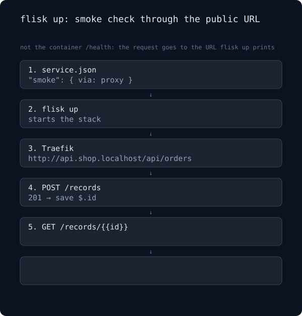

# Vérification de bon fonctionnement (smoke check)

> Ceci est la traduction française de [smoke.md](smoke.md). En cas de différence, la version anglaise prévaut.

`flisk up` peut vérifier votre service par l'URL qu'il affiche, et pas seulement à l'intérieur du conteneur. Le schéma parcourt deux fois le même chemin : la route fonctionne (201, puis 200, "Smoke check passed"), puis la relecture renvoie 404 ("Smoke check failed", `flisk up` se termine avec le code 1). <!-- spellchecker:disable-line -->

<p align="center">
   <!-- spellchecker:disable-line -->
</p>

La vue blob de GitHub affiche souvent ce schéma sans l'animation. [Ouvrez le SVG brut](assets/smoke.svg) pour le voir boucler (environ 16 secondes : 8 pour le succès, 8 pour l'échec).

```json
{
  "smoke": {
    "via": "proxy",
    "timeoutSeconds": 60,
    "steps": [
      { "name": "create", "method": "POST", "path": "/records", "body": { "name": "smoke" }, "expect": 201, "save": { "id": "$.id" } },
      { "name": "read back", "path": "/records/{{id}}", "expect": 200, "bodyContains": "smoke" }
    ]
  }
}
```

La vérification interroge l'URL publique qu'affiche `flisk up`, pas le `/health` du conteneur.

L'extrait de corps dans une ligne d'échec est un court extrait sur une ligne, destiné au terminal, et il n'est pas conservé. La copie retenue est l'enregistrement sous `.flisk/smoke/<service>/<step-slug>/` (corps complet jusqu'à 64 Kio, plus la dernière réponse réussie), vers lequel la ligne d'échec pointe. <!-- spellchecker:disable-line -->

Avant que quoi que ce soit soit affiché ou stocké, le texte est masqué : les valeurs secrètes du `.env` du projet, les mêmes que `flisk logs` et `flisk doctor` masquent, sont remplacées par `[REDACTED]`. Cela couvre le corps stocké, la copie du dernier succès, l'extrait affiché, ainsi que l'URL et l'erreur conservées dans l'enregistrement. Ce n'est pas un scanner de secrets : il couvre les valeurs que le `.env` contient, et rien d'autre, donc un projet sans `.env` lisible n'a rien à masquer. Si le `.env` existe mais ne peut pas être lu, le corps n'est ni affiché ni stocké, l'enregistrement ne garde que les métadonnées sûres, et `flisk up` le signale. <!-- spellchecker:disable-line -->

Les enregistrements sont ignorés par défaut : `flisk up` s'assure que le `.gitignore` du projet ignore `.flisk/smoke/` avant d'écrire le premier enregistrement, et avertit quand il ne peut pas. L'ignore de Git n'est que préventif : il ne retire pas du suivi les fichiers ajoutés auparavant, et n'enlève rien des commits antérieurs. <!-- spellchecker:disable-line -->

Les enregistrements survivent à `flisk down`, donc un échec reste lisible après l'arrêt des conteneurs. Ils restent jusqu'à ce qu'une exécution ultérieure les écrase ou que vous les supprimiez : `rm -rf .flisk/smoke/`. <!-- spellchecker:disable-line -->

En CI, la suite `smoke` de `.github/workflows-disabled/e2e-journeys.yml` téléverse les enregistrements de son projet de vérification jetable comme artefact `smoke-records-*` (14 jours), même quand l'exécution échoue. Un artefact de workflow est lisible par quiconque peut lire l'exécution, donc ne pointez pas un workflow vers une étape smoke dont la réponse renvoie un identifiant que le `.env` ne contient pas. <!-- spellchecker:disable-line -->

Chaque champ, les règles de nouvelle tentative et ce qui n'est pas couvert sont dans [Configuration : `smoke`](configuration.md#smoke-check-the-public-url-after-flisk-up). `tests/e2e/journeys/smoke/verify-smoke.sh` exécute les deux résultats à travers un vrai `flisk up`.
