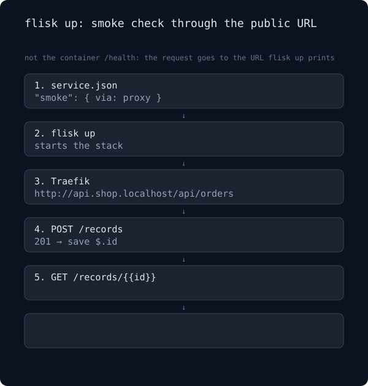

# Verificação de funcionamento

> Esta página é uma tradução em português de [smoke.md](smoke.md).

O `flisk up` pode verificar o seu serviço pela URL que ele imprime, não só dentro do contêiner. O desenho percorre o mesmo caminho duas vezes: primeiro a rota funciona (201, depois 200, "Smoke check passed"), depois a releitura retorna 404 ("Smoke check failed", `flisk up` sai com código 1).

<p align="center">
  
</p>

A visualização de blob do GitHub costuma mostrar esse desenho sem a animação. [Abra o SVG bruto](assets/smoke.svg) para vê-lo em loop (cerca de 16 segundos: 8 do sucesso, 8 da falha).

```json
{
  "smoke": {
    "via": "proxy",
    "timeoutSeconds": 60,
    "steps": [
      { "name": "create", "method": "POST", "path": "/records", "body": { "name": "smoke" }, "expect": 201, "save": { "id": "$.id" } },
      { "name": "read back", "path": "/records/{{id}}", "expect": 200, "bodyContains": "smoke" }
    ]
  }
}
```

A verificação atinge a URL pública que o `flisk up` imprime, não o `/health` do contêiner.

O trecho do corpo numa linha de falha é um excerto curto de uma linha para o terminal e não é guardado. A cópia retida é o registro em `.flisk/smoke/<service>/<step-slug>/` (corpo completo até 64 KiB, mais a última resposta bem-sucedida), para o qual a linha de falha aponta.

Antes de qualquer coisa ser mostrada ou armazenada, o texto é mascarado: os valores secretos do `.env` do próprio projeto — os mesmos que `flisk logs` e `flisk doctor` mascaram — são substituídos por `[REDACTED]`. Isso cobre o corpo armazenado, a cópia do último sucesso, o trecho impresso e a URL e o erro guardados no registro. Não é um scanner de segredos: ele cobre apenas os valores que o `.env` contém, e nada mais, então um projeto sem `.env` legível não tem nada a mascarar. Se o `.env` existe mas não pode ser lido, o corpo não é mostrado nem armazenado, o registro guarda só os metadados seguros, e o `flisk up` avisa. <!-- spellchecker:disable-line -->

Os registros são ignorados por padrão: o `flisk up` garante que o `.gitignore` do projeto ignore `.flisk/smoke/` antes de escrever o primeiro registro, e avisa quando não consegue. O ignore do Git é só preventivo: ele não remove do rastreamento arquivos que já foram adicionados, e não tira nada de commits anteriores. <!-- spellchecker:disable-line -->

Os registros sobrevivem ao `flisk down`, então uma falha ainda pode ser lida depois que os contêineres param. Eles ficam até uma execução posterior sobrescrevê-los ou você apagá-los: `rm -rf .flisk/smoke/`. <!-- spellchecker:disable-line -->

Na CI, a suíte `smoke` de `.github/workflows/e2e-journeys.yml` envia os registros do seu projeto de verificação descartável como artefato `smoke-records-*` (14 dias), mesmo quando a execução falha. Um artefato de workflow pode ser lido por qualquer pessoa que consiga ler a execução, então não aponte um workflow para um passo de smoke cuja resposta repita uma credencial que o `.env` não contém. <!-- spellchecker:disable-line -->

Todos os campos, as regras de repetição e o que não é coberto estão em [Configuração: `smoke`](configuration.md#smoke-check-the-public-url-after-flisk-up). O `tests/e2e/journeys/smoke/verify-smoke.sh` executa os dois resultados através de um `flisk up` real.
